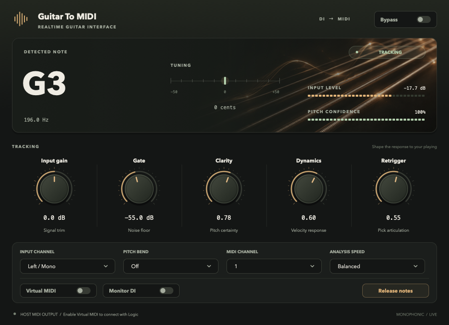

# Guitar To MIDI

**English** | [简体中文](README.zh-CN.md)

A real-time, monophonic **guitar DI → MIDI** converter for **Apple Silicon**. Play software instruments with your guitar using an **Audio Unit (AU), VST3, or standalone app**.



*Actual plugin UI rendered with a synthetic G3 signal. Artwork is embedded in the plugin.*

## Features

- Single-note tracking for melodies, solos, repeated picking, slides, and bends.
- MIDI note-on/note-off, velocity, MIDI channel selection, and optional pitch bend.
- A dedicated CoreMIDI virtual output for routing to Logic Pro or GarageBand.
- Gain, gate, pitch confidence, dynamics, retrigger sensitivity, and three analysis speeds.
- Live note, tuning, input-level, and confidence displays with Retina-ready native controls.
- Note cleanup on bypass, configuration changes, device restarts, and shutdown.

This version tracks **one note at a time**. Chords do not produce reliable polyphonic MIDI. The intended range is approximately **70–1350 Hz**, covering standard six-string guitar, Drop D, and high-register single notes. Bass guitar and lower tunings are outside that range.

## Build and install

The supported target is **macOS on Apple Silicon (arm64)**. You need Git, Apple Command Line Tools, **CMake 3.22+**, and Ninja. The command-line build does not require full Xcode.

If needed, install Apple's tools with `xcode-select --install`. If you already use [Homebrew](https://brew.sh), install the other tools with `brew install cmake ninja`.

```bash
git clone --recurse-submodules https://github.com/letitabcd/GuitarToMIDI.git
cd GuitarToMIDI
./scripts/build-and-install.sh
```

The script builds Release arm64 binaries, runs all four test suites, applies a local ad-hoc signature, installs the bundles, and validates the AU with Apple's `auval`.

| Format | Installed location |
| --- | --- |
| AU | `~/Library/Audio/Plug-Ins/Components/Guitar To MIDI.component` |
| VST3 | `~/Library/Audio/Plug-Ins/VST3/Guitar To MIDI.vst3` |
| Standalone | `~/Applications/Guitar To MIDI.app` |

Existing installed bundles are backed up to the project's `.backups/` directory. Reopen your DAW after installation. Builds are **ad-hoc signed**, without Developer ID signing or notarization. This repository provides source; build locally with the commands above.

JUCE **9.0.3** is a Git submodule pinned to `be29c81492b6151c8ea8d14c840e1311963b3a83`. If you cloned without submodules, or downloaded GitHub's source ZIP, fetch the dependency before building:

```bash
# For a Git clone:
git submodule update --init --recursive

# For a source ZIP with no Git metadata:
git clone --depth 1 --branch 9.0.3 https://github.com/juce-framework/JUCE.git deps/JUCE
```

Build without installing:

```bash
cmake -S . -B build -G Ninja -DCMAKE_BUILD_TYPE=Release -DCMAKE_OSX_ARCHITECTURES=arm64
cmake --build build --parallel 4
ctest --test-dir build --output-on-failure
```

## Logic Pro: use the AU

Use **two tracks**: an audio track converts guitar input, and a software instrument track plays MIDI.

```text
Guitar → audio interface → audio track / Guitar To MIDI
                              ↓ Virtual MIDI
                         software instrument → speakers / headphones
```

1. Connect the guitar to your interface's **Hi-Z / Instrument** input. Choose the interface in **Logic Pro → Settings → Audio → Devices**.
2. Create a **mono audio track**, select the guitar's input (for example, Input 1), and enable its **I / Input Monitoring** button.
3. Insert **Audio FX → Audio Units → renyi → Guitar To MIDI** on that track, before any distortion, reverb, or delay.
4. Turn **Virtual MIDI on**, leave **Monitor DI off** and **Bypass off**, and start with **Input Channel: Left / Mono**, **MIDI Channel: 1**, and **Pitch Bend: Off**. The plugin's bottom line shows its virtual port name, usually `Guitar To MIDI`; additional instances use numbered ports.
5. Open **Logic Pro → Settings → MIDI → Inputs** and enable that exact port. If the Inputs pane is unavailable, enable **Complete Features** in Advanced settings first.
6. Create a **software instrument track**, load a piano or synth patch, select the track, and enable **R / Record Enable**. If your Logic version offers a **MIDI In Port** in the Track inspector, select the plugin's port; otherwise start with the default MIDI routing. Keep **I enabled on the guitar audio track**.
7. Play single notes. The plugin should display notes and input levels, and the instrument should sound. Record the **software instrument track** to save editable MIDI notes.

If tracking stops when you select the instrument track, open **Settings → Audio → General**, enable **Software Monitoring**, and disable the option restricting input monitoring to the focused track. The guitar track must keep processing input while the instrument track is selected.

The AU is an audio effect (`aufx`) loaded in the audio track's Audio FX slot. This Logic workflow uses the plugin's **CoreMIDI virtual output** to connect the tracks.

Apple references: [MIDI Inputs](https://support.apple.com/en-gb/guide/logicpro/lgcp418a5bbb/11.2/mac/14.4), [General Audio settings](https://support.apple.com/en-bh/guide/logicpro/lgcp0ed343a9/mac), and [input monitoring latency](https://support.apple.com/en-ie/105040). Menu labels can vary by Logic version and language.

## GarageBand and standalone

For GarageBand, start with the standalone converter:

1. Open `~/Applications/Guitar To MIDI.app`.
2. In **Options → Audio/MIDI Settings**, select the interface and guitar input. Allow microphone/audio-input access when macOS asks.
3. The app automatically enables virtual MIDI output. Leave **Monitor DI off** to hear only the instrument.
4. In GarageBand, create and select a **software instrument track**, load a patch, and receive notes from the converter's `Guitar To MIDI` virtual port.

Use only one active conversion source. Running the standalone app and an AU instance with Virtual MIDI enabled can send duplicate notes.

Other VST3 hosts can use their audio-to-MIDI routing if supported, or receive the converter's CoreMIDI virtual port. VST3 is built, but host routing differs; this guide focuses on Logic and GarageBand.

## Controls

| Control | Purpose / starting value |
| --- | --- |
| Input gain | Detection gain, **0 dB**. Aim for roughly **−18 to −6 dBFS** while picking; avoid interface clipping. |
| Gate | Noise threshold, **−55 dBFS**. Set above idle noise; too high cuts off soft notes and decay. |
| Clarity | Pitch confidence threshold, **0.78**. Lower values trigger more easily but can increase false notes. |
| Dynamics | Velocity response to playing strength, **0.60**. |
| Retrigger | Sensitivity to picking the same note again, **0.55**. |
| Input Channel | **Left / Mono**, Right, or L + R. Select the connected side of stereo input; mono uses its only input. |
| Pitch Bend | **Off**, ±1, ±2, ±7, or ±12 semitones. Sends RPN bend-range messages; manually match the range in instruments that ignore RPN. |
| MIDI Channel | **1–16**, default **1**. |
| Analysis Speed | Fast / **Balanced** / Precise. Fast uses a shorter window; start with Balanced. |
| Virtual MIDI | Separate CoreMIDI output in AU/VST3, default off. Always enabled in standalone. |
| Monitor DI | Passes dry guitar audio through the converter, default **off**. |
| Bypass | Stops tracking and releases the current MIDI note. |
| Release notes | Releases notes, sends All Notes Off / All Sound Off, and resets bend. Use if the receiving instrument gets stuck. |

Double-click knobs to restore defaults; hover for tooltips. Slides keep the same MIDI note within the selected bend range; beyond it, a new note is sent. For distinct keyboard-style notes, start with **Pitch Bend off**.

## Troubleshooting

| Symptom | Check |
| --- | --- |
| Plugin missing in Logic | Reopen Logic. In **Settings → Plug-in Manager**, find **renyi / Guitar To MIDI** and check validation; reset/rescan that selection if needed. |
| No note or input level | Check interface, track input, audio-input permission, Input Channel, I, and Bypass. Lower an overly high Gate. |
| Notes displayed but no instrument sound | Enable Virtual MIDI and the matching Logic MIDI input, select/arm the instrument track, and check its instrument, output, and MIDI channel. |
| Tracking stops when changing tracks | Enable Software Monitoring, disable focused-track-only monitoring, and keep the guitar track's I on. |
| Dry guitar also audible | Turn Monitor DI off and disable the interface's direct monitoring if you want only the instrument. |
| Duplicate notes | Stop other converter instances/standalone, or filter the instrument to one virtual port. |
| Wrong or unstable notes | Use clean DI, mute unused strings, play one note at a time, avoid clipping, and adjust Gate/Clarity. |
| Stuck notes | Click Release notes and check the receiving instrument's sustain settings. |
| Excessive delay | Start at 48 kHz with 64 or 128 samples. Try Fast and reduce other high-latency effects. Increase the buffer for overloads/dropouts. |

## Validation and latency

Four automated test suites cover:

- `dsp_tests`: synthetic Karplus–Strong plucks, pitch, velocity, gating, and melodies.
- `dsp_regression_tests`: 44.1/48/96 kHz, all analysis speeds, Drop D through high notes, octave transitions, repeated notes, slides/bends, invalid input, and audio-thread allocations.
- `processor_tests`: actual JUCE processing, all 16 channels, bypass, note cleanup, saved state, input selection, oversized/empty buffers, and editor controls.
- `au_integration_tests`: the actual arm64 AU with synthetic audio, host MIDI callbacks, and real CoreMIDI note-on/note-off reception.

The local build passes all four suites and Apple's AU validation. The owner has reported successful guitar use; wider host/device compatibility has not been exhaustively tested.

In the standard synthetic-pluck test, Balanced mode produces notes approximately **17–52 ms** after input onset. This is algorithm onset latency, **excluding** interface conversion, host buffers, virtual MIDI scheduling, and instrument latency; it is not an end-to-end live-guitar measurement.

## Source and artwork

| Path | Contents |
| --- | --- |
| `Source/PitchEngine.*` | Pure C++ filtering, FFT autocorrelation, MPM/NSDF estimation, and note state machine. |
| `Source/PluginProcessor.*` | Parameters, input selection, host MIDI, RPN bend range, and note cleanup. |
| `Source/VirtualMidiOutput.*` | Fixed-size queue and worker-thread CoreMIDI output. |
| `Source/PluginEditor.*`, `Source/PluginLookAndFeel.*` | Native UI, note/tuning displays, meters, and controls. |
| `Source/Standalone.cpp` | Standalone device setup. |
| `scripts/build-and-install.sh` | Build, tests, local signing, backup, installation, and AU validation. |
| `Assets/` | Embedded artwork and its generation prompt. |

The guitar-string artwork was generated for this project using imagegen. See [Assets/README.md](Assets/README.md) for provenance and the exact prompt. No external image files are needed at runtime. Export optional native UI previews with:

```bash
G2M_UI_PREVIEW_DIR="$PWD/docs" ./build/processor_tests
```

Bug reports and contributions are welcome. Include macOS/DAW versions, interface, sample rate, buffer size, plugin settings, and a minimal reproduction. Share only audio recordings you can make public. Run all four tests before submitting audio/MIDI processing changes.

## License

Project code, documentation, and project artwork are provided under **GNU AGPL-3.0-only**, to the extent copyright applies. See [LICENSE](LICENSE) and [NOTICE.md](NOTICE.md).

JUCE 9.0.3 is separately dual-licensed under AGPLv3 and a commercial JUCE license; bundled third-party components retain their own licenses. See [JUCE's license](https://github.com/juce-framework/JUCE/blob/9.0.3/LICENSE.md) and [dependency inventory](https://github.com/juce-framework/JUCE/blob/9.0.3/JUCE.spdx.json). A commercial JUCE license may be required for use outside JUCE's AGPL terms; this repository grants no commercial JUCE license. Initialize the submodule to obtain the framework's source and notices.
